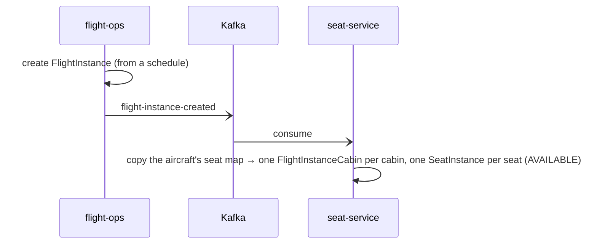
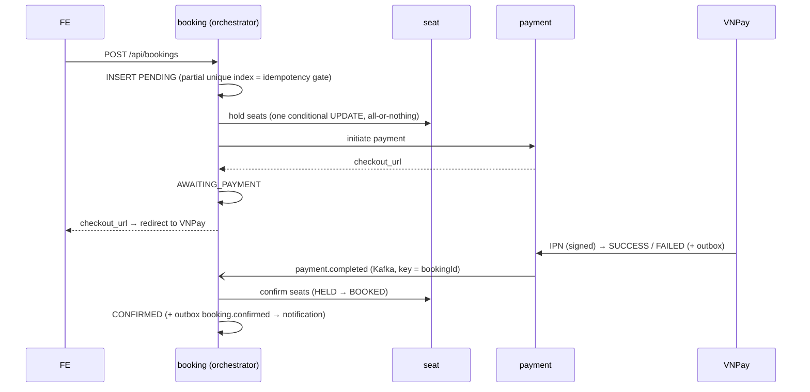

# Architecture

Service list, ports and the tech stack are in the [README](../README.md#services). This page shows how the pieces talk to each other.

## System view

```mermaid
flowchart LR
    FE[React frontend :5173] -->|Bearer JWT| GW[api-gateway :5000]
    KC[Keycloak :8180] -.->|issues JWT| FE
    VNP[VNPay] -->|IPN, public route| GW

    GW -->|X-User-* headers| USER[user-service]
    GW --> CORE[airline-core-service]
    GW --> LOC[location-service]
    GW --> OPS[flight-ops-service]
    GW --> SEAT[seat-service]
    GW --> PRICE[pricing-service]
    GW --> ANC[ancillary-service]
    GW --> BOOK[booking-service]
    GW --> PAY[payment-service]

    OPS --> CORE
    OPS --> LOC
    OPS --> PRICE
    OPS --> SEAT
    BOOK --> OPS
    BOOK --> SEAT
    BOOK --> PAY
    BOOK --> PRICE
    BOOK --> ANC
    BOOK --> USER
    BOOK --> CORE

    OPS -. flight-instance-created .-> K[(Kafka)]
    PAY -. payment.completed / failed .-> K
    BOOK -. booking.confirmed .-> K
    K -.-> SEAT
    K -.-> BOOK
    K -.-> NOTIF[notification-service]
```

Solid arrows are synchronous HTTP (OpenFeign, load-balanced through Eureka, each client with a circuit breaker and fallback). Dotted arrows are Kafka events.

**Platform services:** `service-registry` (Eureka, :8761) for discovery, `config-server` (:8888) serving `config-repo/`, `api-gateway` for auth and routing. Authentication details: [authentication.md](authentication.md).

## Data ownership

One database per service. Services store only the **ids** of things owned by other services and fetch details over Feign.

| Owner | Owns | Referenced by id from |
|---|---|---|
| airline-core | airlines, aircraft | flight-ops, booking |
| location | cities, airports | flight-ops |
| flight-ops | flights (route template), schedules (recurrence), flight instances (one dated departure) | seat, booking |
| seat | cabin classes, seat maps, seat instances (one per seat per departure) | booking (`Ticket.seatInstanceId`) |
| pricing | fares, baggage policies, fare rules | flight-ops (search), booking |
| ancillary | meals, insurance | booking |
| booking (PostgreSQL) | bookings, passengers, tickets | payment |
| payment | payments (VNPay transactions) | booking |

Schemas are managed by Flyway in every service (`db/migration/V{n}__*.sql`, Hibernate `ddl-auto: validate`).

## Key flows

### 1. A new departure gets its seats



Flight-ops never stores seats. Each departure's seat inventory is built asynchronously from the aircraft's template.

### 2. Flight search (`GET /api/flights/search`)

1. **DB filter** in flight-ops: active instances on the date and route, not cancelled / completed / diverted, not departed.
2. If a cabin class is requested: seat-service resolves the cabin for the aircraft (no cabin → flight dropped), pricing-service returns the lowest fare (no fare or outside `minPrice`–`maxPrice` → dropped).
3. **Enrich** each remaining flight with airline (airline-core) and airport (location) details. A failed enrichment call drops that flight instead of failing the search.
4. Flight instances are cached in Redis (`flightInstances`).

### 3. Booking and payment (saga)

Target design of the booking refactor; parts are still being built (status: [PROGRESS.md](booking-refactor/PROGRESS.md)).



Failures are compensated (booking `CANCELLED` / `EXPIRED` + seat release) and a recovery job closes bookings abandoned mid-saga. The full design, with every failure case, is in [booking-refactor/DESIGN.md](booking-refactor/DESIGN.md). Decisions: [decisions.md](decisions.md).

## Cross-cutting

| Concern | How |
|---|---|
| Resilience | OpenFeign + Resilience4j circuit breaker on every client; fallbacks throw 503 rather than fake data |
| Configuration | Spring Cloud Config, Git-backed (`config-repo/`), env-var overrides |
| Caching | Redis (flight instances, notification dedupe) |
| Messaging | Kafka (KRaft); message key = `bookingId` for booking events |
| Local infra | `docker/docker-compose.yml` (full stack), `docker/docker-compose.dev.yml` (infra only) |
