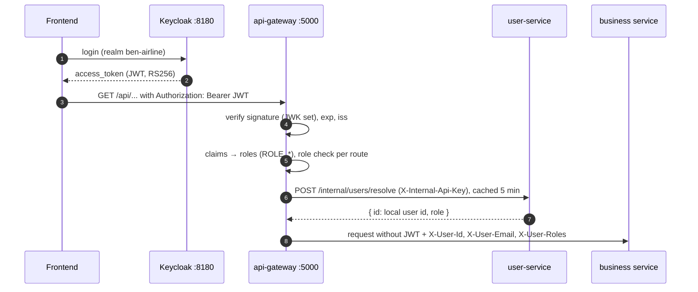

# Authentication and identity

Keycloak issues the token, the API gateway checks it **once**, and every downstream service receives plain trusted headers. No business service ever parses a JWT.

## Steps

| # | Where | What happens | Fails with |
|---|---|---|---|
| 1 | Spring Security (gateway) | JWT signature checked against Keycloak's public keys (`jwk-set-uri`, cached), plus `exp` and `iss` | 401 |
| 2 | `SecurityConfig` | Roles collected from `realm_access.roles` and `resource_access.airline-api.roles`, normalised to `ROLE_*` (`system-admin` → `ROLE_SYSTEM_ADMIN`) | — |
| 3 | `SecurityConfig` | Route-level role check (e.g. `GET /api/airlines` needs `SYSTEM_ADMIN`) | 403 |
| 4 | `UserContextGatewayFilter` | Requires `sub`, `email` and `email_verified = true` | 401 |
| 5 | `LocalUserResolver` | Maps Keycloak `sub` → local numeric user id. Caffeine cache (5 min), otherwise calls user-service through Eureka | 503 if user-service is down |
| 6 | user-service `InternalUserController` | Checks `X-Internal-Api-Key`. Finds the user by Keycloak id, or links an existing account by email, or creates a new one | 409 on identity conflict |
| 7 | Gateway | Removes `Authorization`; sets `X-User-Id`, `X-User-Email`, `X-User-Roles` | — |
| 8 | Business service | Reads the user from `X-User-Id`; `@RequiredRoles` checks `X-User-Roles` | 403 |

## Why this design

- **One translation, in one place.** Keycloak's `sub` is a UUID that means nothing to the services' databases. They need the app's numeric user id and app role. The gateway translates once, instead of every service parsing JWTs.
- **Services stay simple and testable.** A service can be called directly in development with `X-User-Id` / `X-User-Roles` headers (Postman), no Keycloak needed.
- **Trust boundary:** only the gateway is exposed. Services trust the headers because nothing else can reach them; internal service-to-service endpoints additionally require `X-Internal-Api-Key`.

## Public routes

| Route | Why public |
|---|---|
| `/actuator/health`, `/actuator/info`, `/fallback` | Health checks, circuit-breaker fallback |
| `GET /api/payments/vnpay/ipn` | Called server-to-server by VNPay, which has no JWT. Authenticity comes from the HMAC-SHA512 signature check in payment-service |

## Roles

`ROLE_CUSTOMER` (travellers), `ROLE_AIRLINE_OWNER` (manages one airline; the airline is looked up from `X-User-Id`), `ROLE_SYSTEM_ADMIN` (platform administration).

## Configuration

| Key | Default (local) |
|---|---|
| `KEYCLOAK_ISSUER_URI` | `http://localhost:8180/realms/ben-airline` |
| `KEYCLOAK_JWK_SET_URI` | `.../realms/ben-airline/protocol/openid-connect/certs` |
| `KEYCLOAK_CLIENT_ID` | `airline-api` |
| `USER_ID_CACHE_TTL` | `PT5M` |
| `INTERNAL_API_KEY` | set in `docker/.env` (shared by gateway and user-service) |

Realm export for local Keycloak: `docker/keycloak/realm-export.json`.
